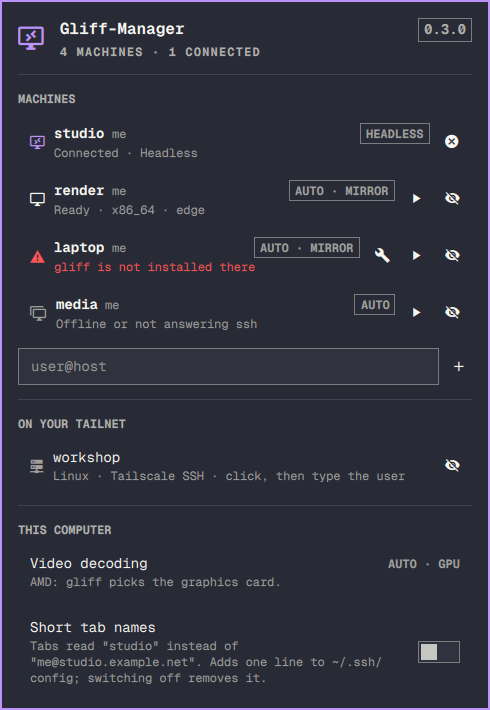

# Gliff-Manager for Nixarchy

A NixOS-ready fork of [Gliff-Manager](https://github.com/28allday/Gliff-Manager) by Gavin Nugent. An [Omarchy](https://omarchy.org) shell plugin for
[gliff](https://github.com/omacom/gliff), the remote desktop for Hyprland. A bar
icon and a dropdown that list your gliff machines, check each one over ssh, fix
the common setup problems, and connect each machine the right way.



> **On nixarchy this is a default.** gliff is preinstalled there and so is this
> plugin; nothing to do. Elsewhere you need gliff on this computer and on every
> machine you connect to.

## What it does

- **Lists your machines**: the ones gliff remembers, plus any you add as
  `user@host`. Linux machines on your Tailscale network are offered too; pick
  one and type the user name, or hide the ones you never connect to.
- **Checks each machine over ssh**, the same way gliff logs in: whether the
  login works, whether gliff is installed, whether a Hyprland session is
  running for that user, and whether a display is plugged in.
- **Picks the mode per machine.** Auto connects to a private headless screen
  when nothing is plugged into the machine, and mirrors its screen when
  something is. Click the mode label to choose Headless, Mirror, or a named
  screen instead.
- **Picks video decoding for this computer.** On a computer with an NVIDIA card
  and a second graphics chip, gliff's GPU decoding can show a black picture, so
  Auto decodes on the processor there. Click the row to choose.
- **Keeps machines of the same mode together as tabs in one gliff window.**
  Machines in different modes get a window each, because gliff applies one
  mode to every tab in a window.
- **Short tab names**, if you want them: gliff names each tab after what it
  connects to, so a tab reads `me@studio.example.net`. Switch on **Short tab
  names** and tabs read `studio`. It works by giving each machine an ssh name:
  Gliff-Manager writes them to its own file and adds one `Include` line to the
  top of `~/.ssh/config`. Switching it off removes that line and leaves your
  ssh config as it was. Names already used by your SSH configuration,
  including included files and matching host patterns, are left alone.
  Machines also keep their full names if shortening would change their
  SSH options (such as ports, keys or jump hosts), if their configuration uses
  conditional `Match` rules, or if the name clashes with another machine.
  As a bonus, `ssh studio` works in a
  terminal too. Changing this setting keeps existing connections tracked.
- **Fixes common problems**, each in a terminal so you type any password
  yourself:

| Shown | What the fix does |
|-------|-------------------|
| gliff is not installed there | Opens a terminal that says how to get gliff on that machine (it runs no package manager) |
| Ready, with a fix button (not on NixOS) | Installs a small `gliff-server` wrapper so plain `gliff` works too (see below) |
| Hyprland runs as another user | Switches the entry to that user, who owns the session |
| Host key not saved yet / changed | Opens an ssh login so you can check and accept the key |
| Tailscale wants you to sign in again | Opens an ssh login and the Tailscale sign-in page in your browser; approve it there |

Status that needs your attention shows in the urgent colour. "Login refused"
means ssh, or Tailscale SSH's policy, does not allow that user. "Sign in
again" comes from a Tailscale SSH policy in check mode: every so often (12
hours by default) it wants a fresh browser sign-in before it lets ssh in.
Connecting checks for this first, so you get the message rather than a gliff
window that hangs.

## What this fork changes

Upstream's helper assumed Arch. Five things broke on NixOS:

1. **A pacman-only scan.** The plugin read the repo channel and usage from
   `pacman-conf`; none of that exists on NixOS. The channel is now the `ID` in
   `/etc/os-release`, and no `pacman` or `yay` appears in the code (CI greps).
2. **The gliff version came from `pacman -Q`.** It now comes from
   `gliff --version` locally and `gliff-server --version` on the remote.
3. **The client process name.** nixpkgs wraps gliff, so the process is
   `.gliff-wrapped`; the helper now finds both names.
4. **The Hyprland owner.** It is `.Hyprland-wrapp` on NixOS (the kernel's
   15-character name), so `ps -C Hyprland` found nothing; it uses `pgrep` now.
5. **Arch-only fixes.** The install fix ran pacman, and the session wrapper
   goes to `/usr/local/bin`; the install fix now explains how to get gliff, and
   the session fix is not offered on NixOS.

## Install

**nixarchy:** a default, nothing to do. Opt out with
`programs.nixarchy.defaultPlugins.gliff-manager = false`.

**Other NixOS**, with Home Manager and gliff installed:

```nix
{
  inputs.nixarchy-gliff-manager.url = "github:olafkfreund/nixarchy-gliff-manager";
  # in your Home Manager configuration:
  imports = [ inputs.nixarchy-gliff-manager.homeManagerModules.default ];
  programs.gliff-manager.enable = true;
}
```

Then run `omarchy plugin enable nixarchy.gliff-manager right` once. The module
steps aside, with a warning, when nixarchy is on.

**Arch:**

```
omarchy plugin add https://github.com/olafkfreund/nixarchy-gliff-manager --enable
```

Then click the icon in the bar, or run:

```
omarchy-shell nixarchy.gliff-manager toggle
```

**Had upstream's copy?** Remove it: `omarchy plugin remove nosignal.gliff-manager`.
Both share `~/.config/gliff-manager/`.

## Requirements

- gliff on this computer and on each remote machine.
- ssh access to each machine with a key: checks run without a password prompt.
- `jq` and, for the Tailscale list, `tailscale`.

## Remove

1. If **Short tab names** is on, switch it off first. That takes its
   `Include` line back out of `~/.ssh/config`.
2. Remove the plugin: `omarchy plugin remove nixarchy.gliff-manager`
   (on nixarchy, set the opt-out above).
3. Delete its settings and cache, if you want them gone too:
   `rm -rf ~/.config/gliff-manager ~/.cache/gliff-manager`.
4. On any machine where you used the session fix, remove the wrapper:
   `sudo rm /usr/local/bin/gliff-server`.

If you removed the plugin with short names still on, open `~/.ssh/config` and
delete the line `# Added by Gliff-Manager: short machine names for gliff tabs`
and the `Include` line under it.

## Using it

| Key | |
|-----|--|
| ↑ ↓ | Move between rows |
| Enter | Connect or disconnect the machine; on a problem, run its fix |
| M | Change the machine's mode |
| F | Run the machine's fix |
| Delete | Hide the machine, or the tailnet machine, from the list. "show them again" under each list brings hidden ones back |
| A | Add a machine |
| R | Check every machine again |

Right-click the bar icon to check every machine again. The icon turns the
accent colour while a gliff window is connected. In a gliff window,
`Shift+Esc` hands your keyboard shortcuts back to your own desktop.

## The session wrapper

On some machines an ssh login gets no `XDG_RUNTIME_DIR`, so `gliff-server`
cannot find the Hyprland session and the connection fails with "find Hyprland
instance". Gliff-Manager works around this by itself when it connects. The fix
button installs `/usr/local/bin/gliff-server`, a three-line script that fills
the variable in and runs the real server, so that plain `gliff` and its saved
tabs work as well.

## What it changes

On this computer, nothing runs with `sudo`. It writes:

- `~/.config/gliff-manager/`: your machine list and choices
  (`machines.json`), and with short names on, the ssh names (`ssh_config`,
  `names.json`).
- `~/.cache/gliff-manager/`: the last check of each machine, and which short
  names running windows were opened with.
- gliff's own `~/.config/gliff/config.toml`: the list of machines to reopen,
  before each launch, and the machine names when short names are switched on
  or off.
- `~/.ssh/config`: only while **Short tab names** is on, and only the one
  `Include` line described above.

On a remote machine, the checks only read. The fix buttons copy a small script
into `~/.cache/gliff-manager/` there, then open a terminal on this computer
where you type the remote password for `sudo` yourself: to install the gliff
package, or the `/usr/local/bin/gliff-server` wrapper. Nothing on a remote
changes without that.

## Good to know

- gliff can't be told to add a tab to a window that is already open. To add a
  machine to an open window, Gliff-Manager closes that window and opens it
  again with the extra tab, so the machines already in it reconnect for a
  moment. On a machine using a private headless screen, that screen is
  recreated, and windows you had on it may move to the machine's other screen.
  Disconnecting one tab works the same way for the tabs that stay.
- When gliff's private headless screen goes away, Hyprland keeps the windows
  that were on it, out of sight. Each time Gliff-Manager connects a machine it
  brings those back: their workspaces move to the new screen, floating
  windows left off-screen are centred, and a new private screen shows the old
  windows instead of an empty workspace. Without this, an app that reuses its
  open window, such as Omarchy's About, seems not to start.
- Gliff-Manager sets gliff's list of machines to reopen before each launch, so
  a plain `gliff` started later may not reconnect the same machines.
- If Tailscale is unavailable, saved machines still load; tailnet suggestions
  return when Tailscale is working again.
- Everything the panel does goes through `gliff-manager.sh`, which you can run
  yourself: `gliff-manager.sh status full`, `gliff-manager.sh connect user@host`,
  and so on. Run it with no arguments for the list.

## Development

`nix flake check` runs the lot (manifest, shellcheck, qmllint, the Home Manager
module and a behaviour test against real processes); `nix develop` gives the tools.

## License

MIT. Gliff-Manager is by Gavin Nugent.
